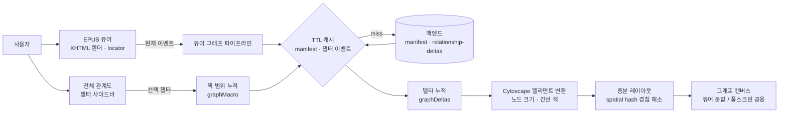

# ReadWith Frontend — 등장인물 관계 그래프 EPUB 뷰어

EPUB을 읽는 동안 지금까지 읽은 위치까지의 등장인물 관계를 그래프로 보여주는 독서 웹앱의 프론트엔드.
관계 그래프는 백엔드가 제공하는 챕터·이벤트 단위 관계 델타를 프론트에서 누적해 그리며, 읽지 않은 부분의 관계는 노출하지 않음.

**팀 프로젝트 → FE 전체 (설계·구현·배포·리팩터링)**

---

## Overview

- **Objective** : 읽는 위치에 맞춘 인물 관계 그래프를 본문 옆에 띄우고, 책 전체 관계망도 챕터별로 탐색
- **Method** : 관계 델타 누적(챕터·이벤트 순) → Cytoscape 엘리먼트 변환 → 증분 레이아웃, TTL 캐시로 재요청 감소
- **Tools** : npm, Vite, Vercel, GitHub Actions

## Features

- XHTML 기반 EPUB 뷰어, 폰트 크기·줄 간격 설정, 읽기 위치(locator) 저장 후 재개
- 뷰어 분할 그래프: 현재 읽는 이벤트까지만 누적해 스포일러 없이 관계 표시, 읽기 진행에 따라 자동 갱신
- 전체 관계도: 챕터 사이드바로 원하는 챕터 시점까지 책 전체 관계 스냅샷 탐색
- 노드 크기는 누적 등장 비중, 간선 색은 누적 긍정도(-100% ~ +100%)
- 간선 상세에서 관계 라벨 변화 타임라인·레이더 차트, 주요 인물 필터·인물 검색 팔레트
- 그래프 캔버스 키보드 탐색, 스크린리더용 `aria-live` 상태 알림
- Google OAuth 로그인, 토큰 만료 임박 시 선제 갱신 + 401 시 1회 재발급 후 재시도
- 서재(EPUB 업로드·정렬·검색), 북마크, 관리자 콘솔(정규화 작업·로그·캐릭터 이미지 관리)

## Tech Stack

- **Framework** : React 19, React Router 7, Vite 6
- **Data** : TanStack Query, `fetch` 기반 인증 클라이언트(`utils/api/client.js`)
- **Visualization** : Cytoscape.js (+ cose-bilkent), Recharts
- **EPUB** : JSZip(파싱), DOMPurify(XHTML sanitize)
- **Style** : 컴포넌트별 CSS + `src/index.css` 디자인 토큰
- **Deploy · CI** : Vercel, GitHub Actions(`keep-backend-warm.yml`), ESLint

---

## Modules

| 모듈 | 역할 |
|---|---|
| `pages/` | 라우트 페이지: Home, My(서재), Viewer, Graph, Bookmarks, Admin (Home 외 lazy 로딩) |
| `components/viewer/` | XHTML 뷰어, 툴바·설정, 본문-그래프 분할(`GraphSplitArea.jsx`) |
| `components/graph/` | `canvas/`·`controls/`·`detail/`은 뷰어·전체 관계도 공용, `page/`는 `/user/graph` 전용 |
| `hooks/viewer/` | 뷰어 상태, 읽기 진행률·자동 저장, 뷰어-그래프 파이프라인(`useViewerGraphPipeline.js`) |
| `hooks/graph/` | 그래프 API 데이터, 뷰 상태, Cytoscape 인스턴스 수명 관리(`useCyLifecycle.js`) |
| `utils/graph/` | 델타 누적(`graphDeltas.js`), 책 범위 그래프(`graphMacro.js`), 레이아웃(`graphLayout.js`), 스타일(`graphStyles.js`) |
| `utils/api/` | 인증 요청·재시도(`client.js`), 토큰 저장·갱신(`authApi.js`), 도서·그래프 API |
| `utils/common/cache/` | TTL 캐시 공용 헬퍼(`cacheManager.js`), 매니페스트·진행률 캐시 |

## Architecture



---

## Getting Started

```bash
npm run install:app          # Frontend-main 의존성 설치
cp Frontend-main/.env.example Frontend-main/.env   # VITE_GOOGLE_CLIENT_ID 필수
npm run dev                  # Vite 개발 서버, /api·/health·/public은 프록시
```

```bash
npm run build && npm run preview
npm run lint --prefix Frontend-main
```

환경 변수 전체 목록, 캐시 TTL, 인증 흐름, 라우트, 코드 규칙: [Frontend-main/README.md](Frontend-main/README.md)

---

## Results

| 지표 | 결과 | 근거 |
|---|---|---|
| 구조 개편 (#40) | 75개 파일, +5,893 / −9,276줄 | `git show --stat 0f81a6c` |
| 공용 모듈 중복 제거 (#41) | `viewerCore.js`(515줄) 등 중복 로직을 공용 모듈로 흡수, 120개 파일 정리 | `git show --stat 5f2459e` |
| 겹침 검사 | 노드 쌍 전수 비교 → spatial hash 인접 셀만 검사(반복당 O(N)), 노드 수 상한 제거 | `utils/graph/graphLayout.js` |
| 초기 번들 | Home 외 페이지 lazy 로딩, react·query·cytoscape 청크 분리, 간선 상세 지연 로딩 | `App.jsx`, `vite.config.js` |
| 백엔드 콜드 스타트 | Render 무료 플랜 슬립(50~90초) 방지, 5분 주기 `/health` 핑 + 재시도 | `.github/workflows/keep-backend-warm.yml` |

## Troubleshooting

| 문제 | 해결 | 드러나는 역량 |
|---|---|---|
| 그래프가 읽지 않은 챕터의 관계까지 보여 스포일러 발생 | 뷰어 그래프는 현재 읽는 이벤트까지만 델타 누적, 전체 관계도와 범위 분리 | 요구사항을 데이터 범위로 구현 |
| 이벤트 순서가 밀려 그래프가 읽는 위치와 어긋남 | 챕터·이벤트 순번 해석을 공용 유틸로 모으고 locator ↔ 진행률 변환 정리 | 상태 동기화 |
| 노드가 많은 책에서 겹침 해소가 노드 쌍 전수 비교라 느림 | spatial hash로 인접 셀만 검사, 증분 갱신은 새 노드와 1·2-hop 이웃만 이동 | 알고리즘 개선 |
| 액세스 토큰 만료 시 요청이 그대로 실패 | 만료 임박 시 선제 갱신, 401이면 1회 재발급 후 원 요청 재시도 | 인증 흐름 설계 |
| 업로드된 EPUB의 XHTML을 그대로 렌더하면 스크립트 주입 위험 | DOMPurify로 sanitize, 빌드 시 CSP 메타 주입(`vite/csp.js`) | 보안 |
| `vite build` 성공 후 Node 핸들이 남아 Vercel 배포가 Building에서 멈춤 | 빌드 종료 시 프로세스 종료 플러그인 추가, 모노레포 루트 `vercel.json`으로 빌드 경로 지정 | 배포 장애 대응 |
| 뷰어·그래프 페이지에 같은 그래프 로직이 중복, 수정할 때 두 곳이 어긋남 | `canvas/`·`controls/`·`detail/`을 공용으로 분리, 페이지 전용은 `page/`로 격리 (#40, #41) | 모듈 분리 |
| 1차 구조 개편(#38) 후 배포 화면 오류 | 즉시 revert(#39), 원인 수정 후 재적용(#40) | 안전한 롤백 |
| 데모 시 백엔드 첫 요청이 50~90초 걸림 | GitHub Actions로 5분마다 `/health` 핑, 타임아웃 6분·재시도 4회 | 운영 비용 없는 우회 |

## Limitations

- 테스트 코드 없음, 회귀는 ESLint와 수동 확인에 의존 → 델타 누적·locator 변환부터 단위 테스트
- 성능 개선 효과를 수치로 측정하지 않음 → 대형 도서 기준 레이아웃 시간·번들 크기 측정
- 리프레시 토큰을 `localStorage`에 저장해 XSS에 노출 → 백엔드와 httpOnly·Secure 쿠키 세션 전환
- 빌드 타겟 `esnext`, 최신 evergreen 브라우저만 지원
- 백엔드 웜업이 무료 플랜 우회책 → 유료 플랜 또는 상시 구동 인스턴스

---

## Contributors

| 단계 | 담당 |
|---|---|
| 1단계 | FE 전체 구현 — 뷰어, 관계 그래프, 서재, 북마크, Google OAuth, 관리자 콘솔, Vercel 배포 |
| 2단계 | 구조 개편, 공용 그래프 모듈 분리·중복 제거, Vercel 배포 수정, 백엔드 웜업 워크플로 |
